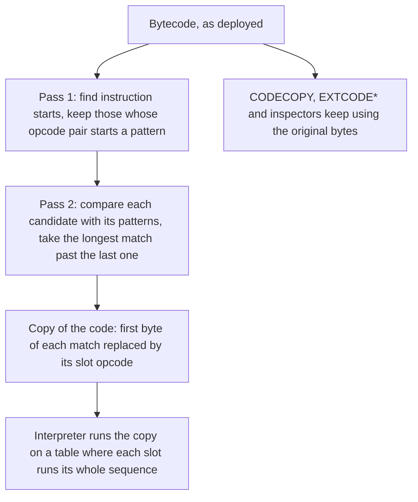

# evm2-sx superinstructions

Generated from [`PATTERNS`](src/lib.rs) at ae99c220, with execution counts from replaying 12,700 mainnet blocks (100-block chunks spread over blocks 25,428,996 to 26,428,995).

## What they are

A superinstruction runs a fixed sequence of ordinary EVM instructions with a single dispatch. It is still a stack instruction: it reads and writes the operand stack exactly as the sequence would, charges the sequence's gas, and reads the sequence's PUSH immediates where they sit in the code. Nothing becomes a register machine.

- **Translation** happens on a contract's 8th frame entry, or ahead of time with `ExecutionConfig::analyze`. It uses the jump destination analysis evm2 already does, and runs at about 1.1 ns per byte of code with AVX-512 (about 2 ns without).
- **Layout is unchanged.** Only the first byte of each matched sequence is overwritten, in a copy of the code. Program counters, jump destinations, `PC`, `CODECOPY` and immediates stay as they were; a superinstruction advances the program counter past its whole sequence, or jumps.
- **Internal only.** Slot opcodes are bytes that are undefined from Frontier through Osaka. If deployed code contains a slot byte as an instruction, translation writes another undefined opcode (0x0C) over it, so it halts exactly as it did before. A contract cannot reach a superinstruction by including its byte.
- **Enabled opcodes only.** A pattern applies only when every opcode in it is enabled and unhooked for the configuration, and its slot is undefined there. Configurations with EIP-8024 (DUPN, SWAPN and EXCHANGE take immediates; Amsterdam) fuse nothing.
- **Same gas.** Each superinstruction charges the summed static gas of its opcodes up front; MLOAD and MSTORE charge memory expansion where they run. A jump that lands on a plain JUMPDEST runs it in place (1 gas) and skips its dispatch. Stack bounds are checked once for the whole sequence. Charging and checking up front only changes which exceptional halt a failing sequence ends with, and every exceptional halt consumes all gas.
- **Constant jumps are checked at translation.** A sequence ending in PUSHn JUMP or PUSHn JUMPI is fused only when its constant target is a JUMPDEST, so the superinstruction jumps without a run-time check.
- **Inspectors** run the original code, so per-step tracing sees every original instruction.

## Effect

On the replayed blocks the 105 superinstructions remove 43.3% of dispatches: 18.52B executed instructions become 10.50B dispatches. Execution speed against regular dispatch, from user-space cycle counters on 600 blocks:

| dispatch backend | cold (translated on 8th entry) | warm (translated ahead) |
|---|---|---|
| tco | x1.056 | x1.109 |
| packed | x1.073 | x1.129 |
| unpacked | x1.071 | x1.129 |

## Reading the entries

- **Stack**: top first. Inputs are `a` (top), `b`, `c`, ...; `k1`, `k2`, ... are the sequence's PUSH immediates in order. `<s` and `>s` are signed comparisons and `>>s` is an arithmetic shift; comparisons and `iszero` give 0 or 1.
- **Needs / grows**: the stack must hold *needs* words, and the sequence goes at most *grows* words above its starting height. These are the only stack checks it does.
- **Gas**: static gas in Osaka, which the superinstruction charges in full before it runs.
- **Runs / saves**: how often it executed on the replayed blocks, and the dispatches it removed as a share of all executed instructions.

## All superinstructions, by dispatches saved

| # | slot | sequence | runs | saves | gas | bytes | kind |
|---|---|---|---|---|---|---|---|
| 2 | `0xB1` | `DUP1 PUSH4 EQ PUSH2 JUMPI` | 161.1M | 3.48% | 22 | 11 | control flow |
| 4 | `0xB3` | `ISZERO PUSH2 JUMPI` | 120.1M | 1.30% | 16 | 5 | control flow |
| 3 | `0xB2` | `PUSH2 JUMP` | 235.4M | 1.27% | 11 | 4 | control flow |
| 5 | `0xB4` | `JUMPDEST PUSH1` | 200.9M | 1.09% | 4 | 3 | stack |
| 34 | `0xD1` | `GT ISZERO PUSH2 JUMPI` | 54.6M | 0.89% | 19 | 6 | control flow |
| 69 | `0x25` | `JUMPDEST SWAP3 SWAP2 POP POP JUMP` | 31.8M | 0.86% | 19 | 6 | control flow |
| 22 | `0xC5` | `PUSH1 PUSH1 PUSH1 SHL SUB` | 39.0M | 0.84% | 15 | 8 | arithmetic |
| 48 | `0xDF` | `PUSH1 ADD SHR SWAP1 PUSH1 SAR PUSH2 JUMP` | 21.6M | 0.82% | 29 | 12 | control flow |
| 101 | `0xF7` | `DUP3 DUP2 MUL SWAP4 SWAP1 SWAP4 ADD SWAP3` | 21.6M | 0.82% | 26 | 8 | arithmetic |
| 24 | `0xC7` | `JUMPDEST PUSH1 DUP2 SGT ISZERO PUSH2 JUMPI` | 21.9M | 0.71% | 26 | 10 | control flow |
| 25 | `0xC8` | `SWAP1 DUP1 MUL PUSH1 DUP2 SWAP1 SHR` | 21.6M | 0.70% | 23 | 8 | arithmetic |
| 1 | `0xB0` | `PUSH2 JUMPI` | 129.2M | 0.70% | 13 | 4 | control flow |
| 54 | `0xE5` | `JUMPDEST DUP4 DUP2 LT ISZERO PUSH2 JUMPI` | 20.0M | 0.65% | 26 | 9 | control flow |
| 71 | `0x27` | `LT ISZERO PUSH2 JUMPI` | 38.7M | 0.63% | 19 | 6 | control flow |
| 93 | `0x0F` | `JUMPDEST PUSH1 PUSH1 PUSH1 SHL SUB` | 23.2M | 0.63% | 16 | 9 | arithmetic |
| 104 | `0xFB` | `PUSH1 PUSH1 PUSH1 SHL SUB AND` | 22.6M | 0.61% | 18 | 9 | arithmetic |
| 14 | `0xBD` | `DUP2 MSTORE PUSH1 ADD` | 36.7M | 0.59% | 12 | 5 | memory |
| 13 | `0xBC` | `SWAP1 JUMP` | 103.3M | 0.56% | 11 | 2 | control flow |
| 15 | `0xBE` | `DUP2 LT ISZERO PUSH2 JUMPI` | 25.2M | 0.54% | 22 | 7 | control flow |
| 8 | `0xB7` | `MSTORE PUSH1` | 99.4M | 0.54% | 6 | 3 | memory |
| 31 | `0xCE` | `SWAP4 SWAP3 POP POP POP JUMP` | 19.7M | 0.53% | 20 | 6 | control flow |
| 44 | `0xDB` | `PUSH2 DUP2 PUSH2 JUMP` | 32.6M | 0.53% | 17 | 8 | control flow |
| 20 | `0xC3` | `DUP1 PUSH4 GT PUSH2 JUMPI` | 24.4M | 0.53% | 22 | 11 | control flow |
| 10 | `0xB9` | `SWAP3 SWAP2 POP POP JUMP` | 22.7M | 0.49% | 18 | 5 | control flow |
| 86 | `0xAB` | `ADD MLOAD DUP4 DUP3 ADD MSTORE PUSH1` | 15.1M | 0.49% | 21 | 8 | memory |
| 9 | `0xB8` | `SWAP1 POP` | 90.1M | 0.49% | 5 | 2 | stack |
| 47 | `0xDE` | `SWAP1 POP SWAP2 SWAP1 POP JUMP` | 17.8M | 0.48% | 21 | 6 | control flow |
| 58 | `0xE9` | `DUP1 ISZERO PUSH2 JUMPI` | 29.4M | 0.48% | 19 | 6 | control flow |
| 33 | `0xD0` | `DUP2 EQ PUSH2 JUMPI` | 28.8M | 0.47% | 19 | 6 | control flow |
| 56 | `0xE7` | `POP POP POP POP` | 28.7M | 0.47% | 8 | 4 | stack |
| 11 | `0xBA` | `PUSH1 ADD` | 85.1M | 0.46% | 6 | 3 | arithmetic |
| 40 | `0xD7` | `ADD PUSH2 JUMP` | 42.3M | 0.46% | 14 | 5 | control flow |
| 37 | `0xD4` | `PUSH2 DUP3 PUSH2 JUMP` | 27.3M | 0.44% | 17 | 8 | control flow |
| 35 | `0xD2` | `GT PUSH2 JUMPI` | 40.9M | 0.44% | 16 | 5 | control flow |
| 38 | `0xD5` | `PUSH1 SWAP1 DUP2 MSTORE PUSH1 PUSH1` | 15.6M | 0.42% | 18 | 9 | memory |
| 98 | `0x4E` | `PUSH1 DUP3 DUP5 SUB SLT ISZERO PUSH2 JUMPI` | 11.1M | 0.42% | 31 | 11 | control flow |
| 65 | `0x21` | `JUMPDEST PUSH1 DUP1` | 38.6M | 0.42% | 7 | 4 | stack |
| 99 | `0x4F` | `DUP2 ADD SWAP1 PUSH2 SWAP2 SWAP1 PUSH2 JUMP` | 11.0M | 0.42% | 29 | 12 | control flow |
| 53 | `0xE4` | `PUSH1 DUP3 ADD` | 37.8M | 0.41% | 9 | 4 | arithmetic |
| 70 | `0x26` | `JUMPDEST SWAP1 POP` | 35.8M | 0.39% | 6 | 3 | stack |
| 21 | `0xC4` | `PUSH20 AND` | 70.1M | 0.38% | 6 | 22 | arithmetic |
| 28 | `0xCB` | `DUP2 LT PUSH2 JUMPI` | 23.1M | 0.37% | 19 | 6 | control flow |
| 55 | `0xE6` | `SWAP1 DUP2 MSTORE PUSH1 ADD PUSH1` | 13.4M | 0.36% | 18 | 8 | memory |
| 66 | `0x22` | `SUB PUSH2 JUMPI` | 33.6M | 0.36% | 16 | 5 | control flow |
| 27 | `0xCA` | `JUMPDEST PUSH0` | 64.4M | 0.35% | 3 | 2 | stack |
| 45 | `0xDC` | `JUMPDEST POP POP` | 31.3M | 0.34% | 5 | 3 | stack |
| 57 | `0xE8` | `PUSH1 PUSH1 MSTORE PUSH1 CALLDATASIZE LT` | 12.3M | 0.33% | 17 | 9 | memory |
| 32 | `0xCF` | `DUP4 ADD` | 59.2M | 0.32% | 6 | 2 | arithmetic |
| 91 | `0x0D` | `DUP2 DUP2` | 59.2M | 0.32% | 6 | 2 | stack |
| 89 | `0xAE` | `JUMPDEST PUSH1 MLOAD` | 29.2M | 0.31% | 7 | 4 | memory |
| 19 | `0xC2` | `SWAP1 DUP2` | 57.1M | 0.31% | 6 | 2 | stack |
| 23 | `0xC6` | `PUSH1 MLOAD` | 56.7M | 0.31% | 6 | 3 | memory |
| 81 | `0xA6` | `SWAP2 POP POP` | 28.3M | 0.31% | 7 | 3 | stack |
| 16 | `0xBF` | `DUP2 ADD` | 55.8M | 0.30% | 6 | 2 | arithmetic |
| 52 | `0xE3` | `DUP3 GT OR PUSH2 JUMPI` | 13.6M | 0.29% | 22 | 7 | control flow |
| 80 | `0xA5` | `DUP4 PUSH2 JUMP` | 27.2M | 0.29% | 14 | 5 | control flow |
| 46 | `0xDD` | `PUSH2 SWAP2 SWAP1 PUSH2 JUMP` | 13.3M | 0.29% | 20 | 9 | control flow |
| 95 | `0x4B` | `PUSH1 PUSH1 MSTORE CALLVALUE DUP1 ISZERO PUSH2 JUMPI` | 7.5M | 0.28% | 30 | 12 | control flow |
| 61 | `0xEC` | `PUSH1 MSTORE` | 50.8M | 0.27% | 6 | 3 | memory |
| 18 | `0xC1` | `POP JUMP` | 49.8M | 0.27% | 10 | 2 | control flow |
| 7 | `0xB6` | `POP POP` | 48.8M | 0.26% | 4 | 2 | stack |
| 30 | `0xCD` | `PUSH1 PUSH1` | 48.8M | 0.26% | 6 | 4 | stack |
| 88 | `0xAD` | `EQ PUSH2 JUMPI` | 24.4M | 0.26% | 16 | 5 | control flow |
| 75 | `0x2B` | `JUMPDEST POP PUSH1 ADD SWAP1 JUMP` | 9.6M | 0.26% | 20 | 7 | control flow |
| 39 | `0xD6` | `DUP1 DUP3` | 48.0M | 0.26% | 6 | 2 | stack |
| 36 | `0xD3` | `SWAP2 POP` | 47.4M | 0.26% | 5 | 2 | stack |
| 87 | `0xAC` | `LT PUSH2 JUMPI` | 23.7M | 0.26% | 16 | 5 | control flow |
| 90 | `0xAF` | `SLT PUSH2 JUMPI` | 23.6M | 0.26% | 16 | 5 | control flow |
| 92 | `0x0E` | `JUMPDEST PUSH2 JUMP` | 23.4M | 0.25% | 12 | 5 | control flow |
| 17 | `0xC0` | `SWAP2 SWAP1` | 45.9M | 0.25% | 6 | 2 | stack |
| 79 | `0x2F` | `DUP2 ADD SWAP1 DUP2 LT PUSH8` | 9.1M | 0.25% | 18 | 14 | arithmetic |
| 94 | `0x1F` | `CALLDATALOAD PUSH1 SHR` | 22.7M | 0.24% | 9 | 4 | call data |
| 12 | `0xBB` | `DUP3 ADD` | 45.1M | 0.24% | 6 | 2 | arithmetic |
| 96 | `0x4C` | `JUMPDEST POP PUSH1 CALLDATASIZE LT PUSH2 JUMPI` | 7.5M | 0.24% | 24 | 10 | control flow |
| 97 | `0x4D` | `JUMPDEST SWAP2 SWAP1` | 22.2M | 0.24% | 7 | 3 | stack |
| 42 | `0xD9` | `DUP2 AND` | 43.7M | 0.24% | 6 | 2 | arithmetic |
| 72 | `0x28` | `PUSH2 PUSH2` | 43.6M | 0.24% | 6 | 6 | stack |
| 83 | `0xA8` | `PUSH2 PUSH1` | 43.6M | 0.24% | 6 | 5 | stack |
| 76 | `0x2C` | `JUMPDEST PUSH2 PUSH2 JUMP` | 14.4M | 0.23% | 15 | 8 | control flow |
| 49 | `0xE0` | `DUP1 SWAP2 SUB SWAP1` | 14.2M | 0.23% | 12 | 4 | arithmetic |
| 51 | `0xE2` | `DUP5 ADD` | 42.6M | 0.23% | 6 | 2 | arithmetic |
| 6 | `0xB5` | `PUSH1 PUSH1 SHL SUB` | 13.9M | 0.22% | 12 | 6 | arithmetic |
| 43 | `0xDA` | `PUSH1 SHL` | 41.4M | 0.22% | 6 | 3 | arithmetic |
| 74 | `0x2A` | `SWAP3 POP` | 39.1M | 0.21% | 5 | 2 | stack |
| 63 | `0xEE` | `SWAP1 SWAP2` | 39.0M | 0.21% | 6 | 2 | stack |
| 67 | `0x23` | `DUP3 DUP3` | 38.3M | 0.21% | 6 | 2 | stack |
| 59 | `0xEA` | `PUSH2 SWAP1` | 37.6M | 0.20% | 6 | 4 | stack |
| 29 | `0xCC` | `PUSH1 SHR` | 36.5M | 0.20% | 6 | 3 | arithmetic |
| 73 | `0x29` | `ISZERO ISZERO` | 36.2M | 0.20% | 6 | 2 | arithmetic |
| 102 | `0xF8` | `JUMPDEST DUP1 DUP3 ADD DUP1 DUP3` | 7.2M | 0.19% | 16 | 6 | arithmetic |
| 62 | `0xED` | `DUP3 AND` | 35.0M | 0.19% | 6 | 2 | arithmetic |
| 64 | `0xEF` | `MLOAD PUSH1` | 34.3M | 0.19% | 6 | 3 | memory |
| 50 | `0xE1` | `PUSH1 DUP1` | 34.2M | 0.18% | 6 | 3 | stack |
| 82 | `0xA7` | `ADD MLOAD` | 33.6M | 0.18% | 6 | 2 | memory |
| 100 | `0xF6` | `ADD MSTORE` | 32.5M | 0.18% | 6 | 2 | memory |
| 85 | `0xAA` | `SWAP2 SWAP1 PUSH4 AND JUMP` | 8.1M | 0.18% | 20 | 9 | control flow |
| 26 | `0xC9` | `DUP2 MSTORE` | 32.2M | 0.17% | 6 | 2 | memory |
| 68 | `0x24` | `PUSH1 NOT` | 32.1M | 0.17% | 6 | 3 | arithmetic |
| 78 | `0x2E` | `PUSH2 MLOAD` | 32.0M | 0.17% | 6 | 4 | memory |
| 60 | `0xEB` | `SWAP2 ADD` | 30.8M | 0.17% | 6 | 2 | arithmetic |
| 84 | `0xA9` | `POP PUSH1` | 30.4M | 0.16% | 5 | 3 | stack |
| 77 | `0x2D` | `DUP1 DUP4 SUB DUP2` | 9.6M | 0.16% | 12 | 4 | arithmetic |
| 103 | `0xF9` | `DUP2 MLOAD` | 24.5M | 0.13% | 6 | 2 | memory |
| 41 | `0xD8` | `DUP1 MLOAD` | 23.5M | 0.13% | 6 | 2 | memory |
| 105 | `0xFC` | `DUP1 CALLDATALOAD` | 20.9M | 0.11% | 6 | 2 | call data |

## Each superinstruction

In the order a greedy search picked them on the replayed blocks: each was the one that removed the most dispatches given the ones before it.

### 1. `0xB0` `PUSH2 JUMPI`

Conditional jump to a constant: the most common branch in compiled code.

- Stack: `[a] → []`; then `jump to k1 if a != 0`
- Gas: 13 (PUSH2 3 + JUMPI 10), plus 1 when the jump lands on a plain JUMPDEST
- Code: 4 bytes; needs 1, grows 1, net -1
- Jump: to the constant `k1`; fused only when it is a JUMPDEST, so no run-time check
- Runs: 129.2M, saving 0.70% of executed instructions
- Applies: Frontier through Osaka

### 2. `0xB1` `DUP1 PUSH4 EQ PUSH2 JUMPI`

Solidity function dispatch: compares the selector with one function's and jumps to its body.

- Stack: `[a] → [a]`; then `jump to k2 if k1 == a`
- Gas: 22 (DUP1 3 + PUSH4 3 + EQ 3 + PUSH2 3 + JUMPI 10), plus 1 when the jump lands on a plain JUMPDEST
- Code: 11 bytes; needs 1, grows 2, net +0
- Jump: to the constant `k2`; fused only when it is a JUMPDEST, so no run-time check
- Runs: 161.1M, saving 3.48% of executed instructions
- Applies: Frontier through Osaka

### 3. `0xB2` `PUSH2 JUMP`

Jump to a constant: internal function calls and returns.

- Stack: `[] → []`; then `jump to k1`
- Gas: 11 (PUSH2 3 + JUMP 8), plus 1 when the jump lands on a plain JUMPDEST
- Code: 4 bytes; needs 0, grows 1, net +0
- Jump: to the constant `k1`; fused only when it is a JUMPDEST, so no run-time check
- Runs: 235.4M, saving 1.27% of executed instructions
- Applies: Frontier through Osaka

### 4. `0xB3` `ISZERO PUSH2 JUMPI`

Jump to a constant if the top word is zero.

- Stack: `[a] → []`; then `jump to k1 if a == 0`
- Gas: 16 (ISZERO 3 + PUSH2 3 + JUMPI 10), plus 1 when the jump lands on a plain JUMPDEST
- Code: 5 bytes; needs 1, grows 1, net -1
- Jump: to the constant `k1`; fused only when it is a JUMPDEST, so no run-time check
- Runs: 120.1M, saving 1.30% of executed instructions
- Applies: Frontier through Osaka

### 5. `0xB4` `JUMPDEST PUSH1`

Block entry that pushes a constant.

- Stack: `[] → [k1]`
- Gas: 4 (JUMPDEST 1 + PUSH1 3)
- Code: 3 bytes; needs 0, grows 1, net +1
- Runs: 200.9M, saving 1.09% of executed instructions
- Applies: Frontier through Osaka

### 6. `0xB5` `PUSH1 PUSH1 SHL SUB`

The end of the mask idiom when its first PUSH1 is fused with what comes before.

- Stack: `[a] → [(k1 << k2) - a]`
- Gas: 12 (PUSH1 3 + PUSH1 3 + SHL 3 + SUB 3)
- Code: 6 bytes; needs 1, grows 2, net +0
- Runs: 13.9M, saving 0.22% of executed instructions
- Applies: Constantinople through Osaka

### 7. `0xB6` `POP POP`

Drops two words.

- Stack: `[a, b] → []`
- Gas: 4 (POP 2 + POP 2)
- Code: 2 bytes; needs 2, grows 0, net -2
- Runs: 48.8M, saving 0.26% of executed instructions
- Applies: Frontier through Osaka

### 8. `0xB7` `MSTORE PUSH1`

- Stack: `[a, b] → [k1]`; then `mem[a] = b`
- Gas: 6 (MSTORE 3 + PUSH1 3), plus memory expansion
- Code: 3 bytes; needs 2, grows 0, net -1
- Runs: 99.4M, saving 0.54% of executed instructions
- Applies: Frontier through Osaka

### 9. `0xB8` `SWAP1 POP`

- Stack: `[a, b] → [a]`
- Gas: 5 (SWAP1 3 + POP 2)
- Code: 2 bytes; needs 2, grows 0, net -1
- Runs: 90.1M, saving 0.49% of executed instructions
- Applies: Frontier through Osaka

### 10. `0xB9` `SWAP3 SWAP2 POP POP JUMP`

Internal function return: drops two arguments and jumps to the return address.

- Stack: `[a, b, c, d] → [a]`; then `jump to d`
- Gas: 18 (SWAP3 3 + SWAP2 3 + POP 2 + POP 2 + JUMP 8), plus 1 when the jump lands on a plain JUMPDEST
- Code: 5 bytes; needs 4, grows 0, net -3
- Jump: to a stack value, checked against the jump destinations at run time
- Runs: 22.7M, saving 0.49% of executed instructions
- Applies: Frontier through Osaka

### 11. `0xBA` `PUSH1 ADD`

Adds a constant, mostly 0x20 or 1.

- Stack: `[a] → [k1 + a]`
- Gas: 6 (PUSH1 3 + ADD 3)
- Code: 3 bytes; needs 1, grows 1, net +0
- Runs: 85.1M, saving 0.46% of executed instructions
- Applies: Frontier through Osaka

### 12. `0xBB` `DUP3 ADD`

- Stack: `[a, b, c] → [c + a, b, c]`
- Gas: 6 (DUP3 3 + ADD 3)
- Code: 2 bytes; needs 3, grows 1, net +0
- Runs: 45.1M, saving 0.24% of executed instructions
- Applies: Frontier through Osaka

### 13. `0xBC` `SWAP1 JUMP`

Internal function return with one result.

- Stack: `[a, b] → [a]`; then `jump to b`
- Gas: 11 (SWAP1 3 + JUMP 8), plus 1 when the jump lands on a plain JUMPDEST
- Code: 2 bytes; needs 2, grows 0, net -1
- Jump: to a stack value, checked against the jump destinations at run time
- Runs: 103.3M, saving 0.56% of executed instructions
- Applies: Frontier through Osaka

### 14. `0xBD` `DUP2 MSTORE PUSH1 ADD`

ABI encoding step: stores a word and advances the pointer by k1 (mostly 0x20).

- Stack: `[a, b] → [k1 + b]`; then `mem[b] = a`
- Gas: 12 (DUP2 3 + MSTORE 3 + PUSH1 3 + ADD 3), plus memory expansion
- Code: 5 bytes; needs 2, grows 1, net -1
- Runs: 36.7M, saving 0.59% of executed instructions
- Applies: Frontier through Osaka

### 15. `0xBE` `DUP2 LT ISZERO PUSH2 JUMPI`

Loop exit check: leaves the loop when i >= n.

- Stack: `[a, b] → [b]`; then `jump to k1 if not (b < a)`
- Gas: 22 (DUP2 3 + LT 3 + ISZERO 3 + PUSH2 3 + JUMPI 10), plus 1 when the jump lands on a plain JUMPDEST
- Code: 7 bytes; needs 2, grows 1, net -1
- Jump: to the constant `k1`; fused only when it is a JUMPDEST, so no run-time check
- Runs: 25.2M, saving 0.54% of executed instructions
- Applies: Frontier through Osaka

### 16. `0xBF` `DUP2 ADD`

- Stack: `[a, b] → [b + a, b]`
- Gas: 6 (DUP2 3 + ADD 3)
- Code: 2 bytes; needs 2, grows 1, net +0
- Runs: 55.8M, saving 0.30% of executed instructions
- Applies: Frontier through Osaka

### 17. `0xC0` `SWAP2 SWAP1`

- Stack: `[a, b, c] → [b, c, a]`
- Gas: 6 (SWAP2 3 + SWAP1 3)
- Code: 2 bytes; needs 3, grows 0, net +0
- Runs: 45.9M, saving 0.25% of executed instructions
- Applies: Frontier through Osaka

### 18. `0xC1` `POP JUMP`

Internal function return that drops one word.

- Stack: `[a, b] → []`; then `jump to b`
- Gas: 10 (POP 2 + JUMP 8), plus 1 when the jump lands on a plain JUMPDEST
- Code: 2 bytes; needs 2, grows 0, net -2
- Jump: to a stack value, checked against the jump destinations at run time
- Runs: 49.8M, saving 0.27% of executed instructions
- Applies: Frontier through Osaka

### 19. `0xC2` `SWAP1 DUP2`

- Stack: `[a, b] → [a, b, a]`
- Gas: 6 (SWAP1 3 + DUP2 3)
- Code: 2 bytes; needs 2, grows 1, net +1
- Runs: 57.1M, saving 0.31% of executed instructions
- Applies: Frontier through Osaka

### 20. `0xC3` `DUP1 PUSH4 GT PUSH2 JUMPI`

Binary-search function dispatch, which contracts with many functions use.

- Stack: `[a] → [a]`; then `jump to k2 if k1 > a`
- Gas: 22 (DUP1 3 + PUSH4 3 + GT 3 + PUSH2 3 + JUMPI 10), plus 1 when the jump lands on a plain JUMPDEST
- Code: 11 bytes; needs 1, grows 2, net +0
- Jump: to the constant `k2`; fused only when it is a JUMPDEST, so no run-time check
- Runs: 24.4M, saving 0.53% of executed instructions
- Applies: Frontier through Osaka

### 21. `0xC4` `PUSH20 AND`

Masks a word to an address with a 20-byte constant.

- Stack: `[a] → [k1 & a]`
- Gas: 6 (PUSH20 3 + AND 3)
- Code: 22 bytes; needs 1, grows 1, net +0
- Runs: 70.1M, saving 0.38% of executed instructions
- Applies: Frontier through Osaka

### 22. `0xC5` `PUSH1 PUSH1 PUSH1 SHL SUB`

Builds a mask such as (1 << 160) - 1, the address mask.

- Stack: `[] → [(k2 << k3) - k1]`
- Gas: 15 (PUSH1 3 + PUSH1 3 + PUSH1 3 + SHL 3 + SUB 3)
- Code: 8 bytes; needs 0, grows 3, net +1
- Runs: 39.0M, saving 0.84% of executed instructions
- Applies: Constantinople through Osaka

### 23. `0xC6` `PUSH1 MLOAD`

Loads a word from a constant address, mostly the free memory pointer at 0x40.

- Stack: `[] → [mem[k1]]`
- Gas: 6 (PUSH1 3 + MLOAD 3), plus memory expansion
- Code: 3 bytes; needs 0, grows 1, net +1
- Runs: 56.7M, saving 0.31% of executed instructions
- Applies: Frontier through Osaka

### 24. `0xC7` `JUMPDEST PUSH1 DUP2 SGT ISZERO PUSH2 JUMPI`

- Stack: `[a] → [a]`; then `jump to k2 if not (a >s k1)`
- Gas: 26 (JUMPDEST 1 + PUSH1 3 + DUP2 3 + SGT 3 + ISZERO 3 + PUSH2 3 + JUMPI 10), plus 1 when the jump lands on a plain JUMPDEST
- Code: 10 bytes; needs 1, grows 2, net +0
- Jump: to the constant `k2`; fused only when it is a JUMPDEST, so no run-time check
- Runs: 21.9M, saving 0.71% of executed instructions
- Applies: Frontier through Osaka

### 25. `0xC8` `SWAP1 DUP1 MUL PUSH1 DUP2 SWAP1 SHR`

- Stack: `[a, b] → [(b * b) >> k1, b * b, a]`
- Gas: 23 (SWAP1 3 + DUP1 3 + MUL 5 + PUSH1 3 + DUP2 3 + SWAP1 3 + SHR 3)
- Code: 8 bytes; needs 2, grows 2, net +1
- Runs: 21.6M, saving 0.70% of executed instructions
- Applies: Constantinople through Osaka

### 26. `0xC9` `DUP2 MSTORE`

- Stack: `[a, b] → [b]`; then `mem[b] = a`
- Gas: 6 (DUP2 3 + MSTORE 3), plus memory expansion
- Code: 2 bytes; needs 2, grows 1, net -1
- Runs: 32.2M, saving 0.17% of executed instructions
- Applies: Frontier through Osaka

### 27. `0xCA` `JUMPDEST PUSH0`

Block entry that pushes zero.

- Stack: `[] → [0]`
- Gas: 3 (JUMPDEST 1 + PUSH0 2)
- Code: 2 bytes; needs 0, grows 1, net +1
- Runs: 64.4M, saving 0.35% of executed instructions
- Applies: Shanghai through Osaka

### 28. `0xCB` `DUP2 LT PUSH2 JUMPI`

- Stack: `[a, b] → [b]`; then `jump to k1 if b < a`
- Gas: 19 (DUP2 3 + LT 3 + PUSH2 3 + JUMPI 10), plus 1 when the jump lands on a plain JUMPDEST
- Code: 6 bytes; needs 2, grows 1, net -1
- Jump: to the constant `k1`; fused only when it is a JUMPDEST, so no run-time check
- Runs: 23.1M, saving 0.37% of executed instructions
- Applies: Frontier through Osaka

### 29. `0xCC` `PUSH1 SHR`

Shift right by a constant.

- Stack: `[a] → [a >> k1]`
- Gas: 6 (PUSH1 3 + SHR 3)
- Code: 3 bytes; needs 1, grows 1, net +0
- Runs: 36.5M, saving 0.20% of executed instructions
- Applies: Constantinople through Osaka

### 30. `0xCD` `PUSH1 PUSH1`

- Stack: `[] → [k2, k1]`
- Gas: 6 (PUSH1 3 + PUSH1 3)
- Code: 4 bytes; needs 0, grows 2, net +2
- Runs: 48.8M, saving 0.26% of executed instructions
- Applies: Frontier through Osaka

### 31. `0xCE` `SWAP4 SWAP3 POP POP POP JUMP`

Internal function return: drops three arguments and jumps to the return address.

- Stack: `[a, b, c, d, e] → [a]`; then `jump to e`
- Gas: 20 (SWAP4 3 + SWAP3 3 + POP 2 + POP 2 + POP 2 + JUMP 8), plus 1 when the jump lands on a plain JUMPDEST
- Code: 6 bytes; needs 5, grows 0, net -4
- Jump: to a stack value, checked against the jump destinations at run time
- Runs: 19.7M, saving 0.53% of executed instructions
- Applies: Frontier through Osaka

### 32. `0xCF` `DUP4 ADD`

- Stack: `[a, b, c, d] → [d + a, b, c, d]`
- Gas: 6 (DUP4 3 + ADD 3)
- Code: 2 bytes; needs 4, grows 1, net +0
- Runs: 59.2M, saving 0.32% of executed instructions
- Applies: Frontier through Osaka

### 33. `0xD0` `DUP2 EQ PUSH2 JUMPI`

- Stack: `[a, b] → [b]`; then `jump to k1 if b == a`
- Gas: 19 (DUP2 3 + EQ 3 + PUSH2 3 + JUMPI 10), plus 1 when the jump lands on a plain JUMPDEST
- Code: 6 bytes; needs 2, grows 1, net -1
- Jump: to the constant `k1`; fused only when it is a JUMPDEST, so no run-time check
- Runs: 28.8M, saving 0.47% of executed instructions
- Applies: Frontier through Osaka

### 34. `0xD1` `GT ISZERO PUSH2 JUMPI`

- Stack: `[a, b] → []`; then `jump to k1 if not (a > b)`
- Gas: 19 (GT 3 + ISZERO 3 + PUSH2 3 + JUMPI 10), plus 1 when the jump lands on a plain JUMPDEST
- Code: 6 bytes; needs 2, grows 0, net -2
- Jump: to the constant `k1`; fused only when it is a JUMPDEST, so no run-time check
- Runs: 54.6M, saving 0.89% of executed instructions
- Applies: Frontier through Osaka

### 35. `0xD2` `GT PUSH2 JUMPI`

- Stack: `[a, b] → []`; then `jump to k1 if a > b`
- Gas: 16 (GT 3 + PUSH2 3 + JUMPI 10), plus 1 when the jump lands on a plain JUMPDEST
- Code: 5 bytes; needs 2, grows 0, net -2
- Jump: to the constant `k1`; fused only when it is a JUMPDEST, so no run-time check
- Runs: 40.9M, saving 0.44% of executed instructions
- Applies: Frontier through Osaka

### 36. `0xD3` `SWAP2 POP`

- Stack: `[a, b, c] → [b, a]`
- Gas: 5 (SWAP2 3 + POP 2)
- Code: 2 bytes; needs 3, grows 0, net -1
- Runs: 47.4M, saving 0.26% of executed instructions
- Applies: Frontier through Osaka

### 37. `0xD4` `PUSH2 DUP3 PUSH2 JUMP`

Internal function call: pushes a return address and an argument and jumps.

- Stack: `[a, b] → [b, k1, a, b]`; then `jump to k2`
- Gas: 17 (PUSH2 3 + DUP3 3 + PUSH2 3 + JUMP 8), plus 1 when the jump lands on a plain JUMPDEST
- Code: 8 bytes; needs 2, grows 3, net +2
- Jump: to the constant `k2`; fused only when it is a JUMPDEST, so no run-time check
- Runs: 27.3M, saving 0.44% of executed instructions
- Applies: Frontier through Osaka

### 38. `0xD5` `PUSH1 SWAP1 DUP2 MSTORE PUSH1 PUSH1`

- Stack: `[a] → [k3, k2, k1]`; then `mem[k1] = a`
- Gas: 18 (PUSH1 3 + SWAP1 3 + DUP2 3 + MSTORE 3 + PUSH1 3 + PUSH1 3), plus memory expansion
- Code: 9 bytes; needs 1, grows 2, net +2
- Runs: 15.6M, saving 0.42% of executed instructions
- Applies: Frontier through Osaka

### 39. `0xD6` `DUP1 DUP3`

- Stack: `[a, b] → [b, a, a, b]`
- Gas: 6 (DUP1 3 + DUP3 3)
- Code: 2 bytes; needs 2, grows 2, net +2
- Runs: 48.0M, saving 0.26% of executed instructions
- Applies: Frontier through Osaka

### 40. `0xD7` `ADD PUSH2 JUMP`

- Stack: `[a, b] → [a + b]`; then `jump to k1`
- Gas: 14 (ADD 3 + PUSH2 3 + JUMP 8), plus 1 when the jump lands on a plain JUMPDEST
- Code: 5 bytes; needs 2, grows 0, net -1
- Jump: to the constant `k1`; fused only when it is a JUMPDEST, so no run-time check
- Runs: 42.3M, saving 0.46% of executed instructions
- Applies: Frontier through Osaka

### 41. `0xD8` `DUP1 MLOAD`

- Stack: `[a] → [mem[a], a]`
- Gas: 6 (DUP1 3 + MLOAD 3), plus memory expansion
- Code: 2 bytes; needs 1, grows 1, net +1
- Runs: 23.5M, saving 0.13% of executed instructions
- Applies: Frontier through Osaka

### 42. `0xD9` `DUP2 AND`

- Stack: `[a, b] → [b & a, b]`
- Gas: 6 (DUP2 3 + AND 3)
- Code: 2 bytes; needs 2, grows 1, net +0
- Runs: 43.7M, saving 0.24% of executed instructions
- Applies: Frontier through Osaka

### 43. `0xDA` `PUSH1 SHL`

Shift left by a constant.

- Stack: `[a] → [a << k1]`
- Gas: 6 (PUSH1 3 + SHL 3)
- Code: 3 bytes; needs 1, grows 1, net +0
- Runs: 41.4M, saving 0.22% of executed instructions
- Applies: Constantinople through Osaka

### 44. `0xDB` `PUSH2 DUP2 PUSH2 JUMP`

Internal function call: pushes a return address and an argument and jumps.

- Stack: `[a] → [a, k1, a]`; then `jump to k2`
- Gas: 17 (PUSH2 3 + DUP2 3 + PUSH2 3 + JUMP 8), plus 1 when the jump lands on a plain JUMPDEST
- Code: 8 bytes; needs 1, grows 3, net +2
- Jump: to the constant `k2`; fused only when it is a JUMPDEST, so no run-time check
- Runs: 32.6M, saving 0.53% of executed instructions
- Applies: Frontier through Osaka

### 45. `0xDC` `JUMPDEST POP POP`

- Stack: `[a, b] → []`
- Gas: 5 (JUMPDEST 1 + POP 2 + POP 2)
- Code: 3 bytes; needs 2, grows 0, net -2
- Runs: 31.3M, saving 0.34% of executed instructions
- Applies: Frontier through Osaka

### 46. `0xDD` `PUSH2 SWAP2 SWAP1 PUSH2 JUMP`

Internal function call: pushes a return address under two arguments and jumps.

- Stack: `[a, b] → [a, b, k1]`; then `jump to k2`
- Gas: 20 (PUSH2 3 + SWAP2 3 + SWAP1 3 + PUSH2 3 + JUMP 8), plus 1 when the jump lands on a plain JUMPDEST
- Code: 9 bytes; needs 2, grows 2, net +1
- Jump: to the constant `k2`; fused only when it is a JUMPDEST, so no run-time check
- Runs: 13.3M, saving 0.29% of executed instructions
- Applies: Frontier through Osaka

### 47. `0xDE` `SWAP1 POP SWAP2 SWAP1 POP JUMP`

Internal function return that keeps one result.

- Stack: `[a, b, c, d] → [a]`; then `jump to d`
- Gas: 21 (SWAP1 3 + POP 2 + SWAP2 3 + SWAP1 3 + POP 2 + JUMP 8), plus 1 when the jump lands on a plain JUMPDEST
- Code: 6 bytes; needs 4, grows 0, net -3
- Jump: to a stack value, checked against the jump destinations at run time
- Runs: 17.8M, saving 0.48% of executed instructions
- Applies: Frontier through Osaka

### 48. `0xDF` `PUSH1 ADD SHR SWAP1 PUSH1 SAR PUSH2 JUMP`

- Stack: `[a, b, c] → [c >>s k2, b >> (k1 + a)]`; then `jump to k3`
- Gas: 29 (PUSH1 3 + ADD 3 + SHR 3 + SWAP1 3 + PUSH1 3 + SAR 3 + PUSH2 3 + JUMP 8), plus 1 when the jump lands on a plain JUMPDEST
- Code: 12 bytes; needs 3, grows 1, net -1
- Jump: to the constant `k3`; fused only when it is a JUMPDEST, so no run-time check
- Runs: 21.6M, saving 0.82% of executed instructions
- Applies: Constantinople through Osaka

### 49. `0xE0` `DUP1 SWAP2 SUB SWAP1`

- Stack: `[a, b] → [a, b - a]`
- Gas: 12 (DUP1 3 + SWAP2 3 + SUB 3 + SWAP1 3)
- Code: 4 bytes; needs 2, grows 1, net +0
- Runs: 14.2M, saving 0.23% of executed instructions
- Applies: Frontier through Osaka

### 50. `0xE1` `PUSH1 DUP1`

- Stack: `[] → [k1, k1]`
- Gas: 6 (PUSH1 3 + DUP1 3)
- Code: 3 bytes; needs 0, grows 2, net +2
- Runs: 34.2M, saving 0.18% of executed instructions
- Applies: Frontier through Osaka

### 51. `0xE2` `DUP5 ADD`

- Stack: `[a, b, c, d, e] → [e + a, b, c, d, e]`
- Gas: 6 (DUP5 3 + ADD 3)
- Code: 2 bytes; needs 5, grows 1, net +0
- Runs: 42.6M, saving 0.23% of executed instructions
- Applies: Frontier through Osaka

### 52. `0xE3` `DUP3 GT OR PUSH2 JUMPI`

- Stack: `[a, b, c] → [c]`; then `jump to k1 if (c > a) | b`
- Gas: 22 (DUP3 3 + GT 3 + OR 3 + PUSH2 3 + JUMPI 10), plus 1 when the jump lands on a plain JUMPDEST
- Code: 7 bytes; needs 3, grows 1, net -2
- Jump: to the constant `k1`; fused only when it is a JUMPDEST, so no run-time check
- Runs: 13.6M, saving 0.29% of executed instructions
- Applies: Frontier through Osaka

### 53. `0xE4` `PUSH1 DUP3 ADD`

- Stack: `[a, b] → [b + k1, a, b]`
- Gas: 9 (PUSH1 3 + DUP3 3 + ADD 3)
- Code: 4 bytes; needs 2, grows 2, net +1
- Runs: 37.8M, saving 0.41% of executed instructions
- Applies: Frontier through Osaka

### 54. `0xE5` `JUMPDEST DUP4 DUP2 LT ISZERO PUSH2 JUMPI`

Loop head: leaves the loop when i >= n.

- Stack: `[a, b, c, d] → [a, b, c, d]`; then `jump to k1 if not (a < d)`
- Gas: 26 (JUMPDEST 1 + DUP4 3 + DUP2 3 + LT 3 + ISZERO 3 + PUSH2 3 + JUMPI 10), plus 1 when the jump lands on a plain JUMPDEST
- Code: 9 bytes; needs 4, grows 2, net +0
- Jump: to the constant `k1`; fused only when it is a JUMPDEST, so no run-time check
- Runs: 20.0M, saving 0.65% of executed instructions
- Applies: Frontier through Osaka

### 55. `0xE6` `SWAP1 DUP2 MSTORE PUSH1 ADD PUSH1`

ABI encoding step: stores a word, advances the pointer and pushes the next constant.

- Stack: `[a, b] → [k2, k1 + a]`; then `mem[a] = b`
- Gas: 18 (SWAP1 3 + DUP2 3 + MSTORE 3 + PUSH1 3 + ADD 3 + PUSH1 3), plus memory expansion
- Code: 8 bytes; needs 2, grows 1, net +0
- Runs: 13.4M, saving 0.36% of executed instructions
- Applies: Frontier through Osaka

### 56. `0xE7` `POP POP POP POP`

Drops four words.

- Stack: `[a, b, c, d] → []`
- Gas: 8 (POP 2 + POP 2 + POP 2 + POP 2)
- Code: 4 bytes; needs 4, grows 0, net -4
- Runs: 28.7M, saving 0.47% of executed instructions
- Applies: Frontier through Osaka

### 57. `0xE8` `PUSH1 PUSH1 MSTORE PUSH1 CALLDATASIZE LT`

Prologue of contracts without a non-payable check: free memory pointer, then whether calldata is shorter than a selector.

- Stack: `[] → [calldatasize < k3]`; then `mem[k2] = k1`
- Gas: 17 (PUSH1 3 + PUSH1 3 + MSTORE 3 + PUSH1 3 + CALLDATASIZE 2 + LT 3), plus memory expansion
- Code: 9 bytes; needs 0, grows 2, net +1
- Runs: 12.3M, saving 0.33% of executed instructions
- Applies: Frontier through Osaka

### 58. `0xE9` `DUP1 ISZERO PUSH2 JUMPI`

- Stack: `[a] → [a]`; then `jump to k1 if a == 0`
- Gas: 19 (DUP1 3 + ISZERO 3 + PUSH2 3 + JUMPI 10), plus 1 when the jump lands on a plain JUMPDEST
- Code: 6 bytes; needs 1, grows 2, net +0
- Jump: to the constant `k1`; fused only when it is a JUMPDEST, so no run-time check
- Runs: 29.4M, saving 0.48% of executed instructions
- Applies: Frontier through Osaka

### 59. `0xEA` `PUSH2 SWAP1`

- Stack: `[a] → [a, k1]`
- Gas: 6 (PUSH2 3 + SWAP1 3)
- Code: 4 bytes; needs 1, grows 1, net +1
- Runs: 37.6M, saving 0.20% of executed instructions
- Applies: Frontier through Osaka

### 60. `0xEB` `SWAP2 ADD`

- Stack: `[a, b, c] → [c + b, a]`
- Gas: 6 (SWAP2 3 + ADD 3)
- Code: 2 bytes; needs 3, grows 0, net -1
- Runs: 30.8M, saving 0.17% of executed instructions
- Applies: Frontier through Osaka

### 61. `0xEC` `PUSH1 MSTORE`

- Stack: `[a] → []`; then `mem[k1] = a`
- Gas: 6 (PUSH1 3 + MSTORE 3), plus memory expansion
- Code: 3 bytes; needs 1, grows 1, net -1
- Runs: 50.8M, saving 0.27% of executed instructions
- Applies: Frontier through Osaka

### 62. `0xED` `DUP3 AND`

- Stack: `[a, b, c] → [c & a, b, c]`
- Gas: 6 (DUP3 3 + AND 3)
- Code: 2 bytes; needs 3, grows 1, net +0
- Runs: 35.0M, saving 0.19% of executed instructions
- Applies: Frontier through Osaka

### 63. `0xEE` `SWAP1 SWAP2`

- Stack: `[a, b, c] → [c, a, b]`
- Gas: 6 (SWAP1 3 + SWAP2 3)
- Code: 2 bytes; needs 3, grows 0, net +0
- Runs: 39.0M, saving 0.21% of executed instructions
- Applies: Frontier through Osaka

### 64. `0xEF` `MLOAD PUSH1`

- Stack: `[a] → [k1, mem[a]]`
- Gas: 6 (MLOAD 3 + PUSH1 3), plus memory expansion
- Code: 3 bytes; needs 1, grows 1, net +1
- Runs: 34.3M, saving 0.19% of executed instructions
- Applies: Frontier through Osaka

### 65. `0x21` `JUMPDEST PUSH1 DUP1`

- Stack: `[] → [k1, k1]`
- Gas: 7 (JUMPDEST 1 + PUSH1 3 + DUP1 3)
- Code: 4 bytes; needs 0, grows 2, net +2
- Runs: 38.6M, saving 0.42% of executed instructions
- Applies: Frontier through Osaka

### 66. `0x22` `SUB PUSH2 JUMPI`

- Stack: `[a, b] → []`; then `jump to k1 if (a - b) != 0`
- Gas: 16 (SUB 3 + PUSH2 3 + JUMPI 10), plus 1 when the jump lands on a plain JUMPDEST
- Code: 5 bytes; needs 2, grows 0, net -2
- Jump: to the constant `k1`; fused only when it is a JUMPDEST, so no run-time check
- Runs: 33.6M, saving 0.36% of executed instructions
- Applies: Frontier through Osaka

### 67. `0x23` `DUP3 DUP3`

- Stack: `[a, b, c] → [b, c, a, b, c]`
- Gas: 6 (DUP3 3 + DUP3 3)
- Code: 2 bytes; needs 3, grows 2, net +2
- Runs: 38.3M, saving 0.21% of executed instructions
- Applies: Frontier through Osaka

### 68. `0x24` `PUSH1 NOT`

Builds a mask such as ~0x1f, used to round sizes to whole words.

- Stack: `[] → [~k1]`
- Gas: 6 (PUSH1 3 + NOT 3)
- Code: 3 bytes; needs 0, grows 1, net +1
- Runs: 32.1M, saving 0.17% of executed instructions
- Applies: Frontier through Osaka

### 69. `0x25` `JUMPDEST SWAP3 SWAP2 POP POP JUMP`

Internal function return at the start of a block.

- Stack: `[a, b, c, d] → [a]`; then `jump to d`
- Gas: 19 (JUMPDEST 1 + SWAP3 3 + SWAP2 3 + POP 2 + POP 2 + JUMP 8), plus 1 when the jump lands on a plain JUMPDEST
- Code: 6 bytes; needs 4, grows 0, net -3
- Jump: to a stack value, checked against the jump destinations at run time
- Runs: 31.8M, saving 0.86% of executed instructions
- Applies: Frontier through Osaka

### 70. `0x26` `JUMPDEST SWAP1 POP`

- Stack: `[a, b] → [a]`
- Gas: 6 (JUMPDEST 1 + SWAP1 3 + POP 2)
- Code: 3 bytes; needs 2, grows 0, net -1
- Runs: 35.8M, saving 0.39% of executed instructions
- Applies: Frontier through Osaka

### 71. `0x27` `LT ISZERO PUSH2 JUMPI`

- Stack: `[a, b] → []`; then `jump to k1 if not (a < b)`
- Gas: 19 (LT 3 + ISZERO 3 + PUSH2 3 + JUMPI 10), plus 1 when the jump lands on a plain JUMPDEST
- Code: 6 bytes; needs 2, grows 0, net -2
- Jump: to the constant `k1`; fused only when it is a JUMPDEST, so no run-time check
- Runs: 38.7M, saving 0.63% of executed instructions
- Applies: Frontier through Osaka

### 72. `0x28` `PUSH2 PUSH2`

- Stack: `[] → [k2, k1]`
- Gas: 6 (PUSH2 3 + PUSH2 3)
- Code: 6 bytes; needs 0, grows 2, net +2
- Runs: 43.6M, saving 0.24% of executed instructions
- Applies: Frontier through Osaka

### 73. `0x29` `ISZERO ISZERO`

Normalizes a word to a boolean.

- Stack: `[a] → [iszero(iszero(a))]`
- Gas: 6 (ISZERO 3 + ISZERO 3)
- Code: 2 bytes; needs 1, grows 0, net +0
- Runs: 36.2M, saving 0.20% of executed instructions
- Applies: Frontier through Osaka

### 74. `0x2A` `SWAP3 POP`

- Stack: `[a, b, c, d] → [b, c, a]`
- Gas: 5 (SWAP3 3 + POP 2)
- Code: 2 bytes; needs 4, grows 0, net -1
- Runs: 39.1M, saving 0.21% of executed instructions
- Applies: Frontier through Osaka

### 75. `0x2B` `JUMPDEST POP PUSH1 ADD SWAP1 JUMP`

- Stack: `[a, b, c] → [k1 + b]`; then `jump to c`
- Gas: 20 (JUMPDEST 1 + POP 2 + PUSH1 3 + ADD 3 + SWAP1 3 + JUMP 8), plus 1 when the jump lands on a plain JUMPDEST
- Code: 7 bytes; needs 3, grows 0, net -2
- Jump: to a stack value, checked against the jump destinations at run time
- Runs: 9.6M, saving 0.26% of executed instructions
- Applies: Frontier through Osaka

### 76. `0x2C` `JUMPDEST PUSH2 PUSH2 JUMP`

Internal function call at the start of a block.

- Stack: `[] → [k1]`; then `jump to k2`
- Gas: 15 (JUMPDEST 1 + PUSH2 3 + PUSH2 3 + JUMP 8), plus 1 when the jump lands on a plain JUMPDEST
- Code: 8 bytes; needs 0, grows 2, net +1
- Jump: to the constant `k2`; fused only when it is a JUMPDEST, so no run-time check
- Runs: 14.4M, saving 0.23% of executed instructions
- Applies: Frontier through Osaka

### 77. `0x2D` `DUP1 DUP4 SUB DUP2`

- Stack: `[a, b, c] → [a, c - a, a, b, c]`
- Gas: 12 (DUP1 3 + DUP4 3 + SUB 3 + DUP2 3)
- Code: 4 bytes; needs 3, grows 2, net +2
- Runs: 9.6M, saving 0.16% of executed instructions
- Applies: Frontier through Osaka

### 78. `0x2E` `PUSH2 MLOAD`

- Stack: `[] → [mem[k1]]`
- Gas: 6 (PUSH2 3 + MLOAD 3), plus memory expansion
- Code: 4 bytes; needs 0, grows 1, net +1
- Runs: 32.0M, saving 0.17% of executed instructions
- Applies: Frontier through Osaka

### 79. `0x2F` `DUP2 ADD SWAP1 DUP2 LT PUSH8`

- Stack: `[a, b] → [k1, (b + a) < b, b + a]`
- Gas: 18 (DUP2 3 + ADD 3 + SWAP1 3 + DUP2 3 + LT 3 + PUSH8 3)
- Code: 14 bytes; needs 2, grows 1, net +1
- Runs: 9.1M, saving 0.25% of executed instructions
- Applies: Frontier through Osaka

### 80. `0xA5` `DUP4 PUSH2 JUMP`

- Stack: `[a, b, c, d] → [d, a, b, c, d]`; then `jump to k1`
- Gas: 14 (DUP4 3 + PUSH2 3 + JUMP 8), plus 1 when the jump lands on a plain JUMPDEST
- Code: 5 bytes; needs 4, grows 2, net +1
- Jump: to the constant `k1`; fused only when it is a JUMPDEST, so no run-time check
- Runs: 27.2M, saving 0.29% of executed instructions
- Applies: Frontier through Osaka

### 81. `0xA6` `SWAP2 POP POP`

- Stack: `[a, b, c] → [a]`
- Gas: 7 (SWAP2 3 + POP 2 + POP 2)
- Code: 3 bytes; needs 3, grows 0, net -2
- Runs: 28.3M, saving 0.31% of executed instructions
- Applies: Frontier through Osaka

### 82. `0xA7` `ADD MLOAD`

- Stack: `[a, b] → [mem[a + b]]`
- Gas: 6 (ADD 3 + MLOAD 3), plus memory expansion
- Code: 2 bytes; needs 2, grows 0, net -1
- Runs: 33.6M, saving 0.18% of executed instructions
- Applies: Frontier through Osaka

### 83. `0xA8` `PUSH2 PUSH1`

- Stack: `[] → [k2, k1]`
- Gas: 6 (PUSH2 3 + PUSH1 3)
- Code: 5 bytes; needs 0, grows 2, net +2
- Runs: 43.6M, saving 0.24% of executed instructions
- Applies: Frontier through Osaka

### 84. `0xA9` `POP PUSH1`

- Stack: `[a] → [k1]`
- Gas: 5 (POP 2 + PUSH1 3)
- Code: 3 bytes; needs 1, grows 0, net +0
- Runs: 30.4M, saving 0.16% of executed instructions
- Applies: Frontier through Osaka

### 85. `0xAA` `SWAP2 SWAP1 PUSH4 AND JUMP`

- Stack: `[a, b, c] → [c, a]`; then `jump to k1 & b`
- Gas: 20 (SWAP2 3 + SWAP1 3 + PUSH4 3 + AND 3 + JUMP 8), plus 1 when the jump lands on a plain JUMPDEST
- Code: 9 bytes; needs 3, grows 1, net -1
- Jump: to a stack value, checked against the jump destinations at run time
- Runs: 8.1M, saving 0.18% of executed instructions
- Applies: Frontier through Osaka

### 86. `0xAB` `ADD MLOAD DUP4 DUP3 ADD MSTORE PUSH1`

- Stack: `[a, b, c, d, e] → [k1, c, d, e]`; then `mem[c + e] = mem[a + b]`
- Gas: 21 (ADD 3 + MLOAD 3 + DUP4 3 + DUP3 3 + ADD 3 + MSTORE 3 + PUSH1 3), plus memory expansion
- Code: 8 bytes; needs 5, grows 1, net -1
- Runs: 15.1M, saving 0.49% of executed instructions
- Applies: Frontier through Osaka

### 87. `0xAC` `LT PUSH2 JUMPI`

- Stack: `[a, b] → []`; then `jump to k1 if a < b`
- Gas: 16 (LT 3 + PUSH2 3 + JUMPI 10), plus 1 when the jump lands on a plain JUMPDEST
- Code: 5 bytes; needs 2, grows 0, net -2
- Jump: to the constant `k1`; fused only when it is a JUMPDEST, so no run-time check
- Runs: 23.7M, saving 0.26% of executed instructions
- Applies: Frontier through Osaka

### 88. `0xAD` `EQ PUSH2 JUMPI`

- Stack: `[a, b] → []`; then `jump to k1 if a == b`
- Gas: 16 (EQ 3 + PUSH2 3 + JUMPI 10), plus 1 when the jump lands on a plain JUMPDEST
- Code: 5 bytes; needs 2, grows 0, net -2
- Jump: to the constant `k1`; fused only when it is a JUMPDEST, so no run-time check
- Runs: 24.4M, saving 0.26% of executed instructions
- Applies: Frontier through Osaka

### 89. `0xAE` `JUMPDEST PUSH1 MLOAD`

Loads the free memory pointer at the start of a block.

- Stack: `[] → [mem[k1]]`
- Gas: 7 (JUMPDEST 1 + PUSH1 3 + MLOAD 3), plus memory expansion
- Code: 4 bytes; needs 0, grows 1, net +1
- Runs: 29.2M, saving 0.31% of executed instructions
- Applies: Frontier through Osaka

### 90. `0xAF` `SLT PUSH2 JUMPI`

- Stack: `[a, b] → []`; then `jump to k1 if a <s b`
- Gas: 16 (SLT 3 + PUSH2 3 + JUMPI 10), plus 1 when the jump lands on a plain JUMPDEST
- Code: 5 bytes; needs 2, grows 0, net -2
- Jump: to the constant `k1`; fused only when it is a JUMPDEST, so no run-time check
- Runs: 23.6M, saving 0.26% of executed instructions
- Applies: Frontier through Osaka

### 91. `0x0D` `DUP2 DUP2`

- Stack: `[a, b] → [a, b, a, b]`
- Gas: 6 (DUP2 3 + DUP2 3)
- Code: 2 bytes; needs 2, grows 2, net +2
- Runs: 59.2M, saving 0.32% of executed instructions
- Applies: Frontier through Osaka

### 92. `0x0E` `JUMPDEST PUSH2 JUMP`

- Stack: `[] → []`; then `jump to k1`
- Gas: 12 (JUMPDEST 1 + PUSH2 3 + JUMP 8), plus 1 when the jump lands on a plain JUMPDEST
- Code: 5 bytes; needs 0, grows 1, net +0
- Jump: to the constant `k1`; fused only when it is a JUMPDEST, so no run-time check
- Runs: 23.4M, saving 0.25% of executed instructions
- Applies: Frontier through Osaka

### 93. `0x0F` `JUMPDEST PUSH1 PUSH1 PUSH1 SHL SUB`

Address-mask idiom at the start of a block.

- Stack: `[] → [(k2 << k3) - k1]`
- Gas: 16 (JUMPDEST 1 + PUSH1 3 + PUSH1 3 + PUSH1 3 + SHL 3 + SUB 3)
- Code: 9 bytes; needs 0, grows 3, net +1
- Runs: 23.2M, saving 0.63% of executed instructions
- Applies: Constantinople through Osaka

### 94. `0x1F` `CALLDATALOAD PUSH1 SHR`

Reads the function selector (calldata[0] >> 0xe0).

- Stack: `[a] → [calldata[a] >> k1]`
- Gas: 9 (CALLDATALOAD 3 + PUSH1 3 + SHR 3)
- Code: 4 bytes; needs 1, grows 1, net +0
- Runs: 22.7M, saving 0.24% of executed instructions
- Applies: Constantinople through Osaka

### 95. `0x4B` `PUSH1 PUSH1 MSTORE CALLVALUE DUP1 ISZERO PUSH2 JUMPI`

Solidity contract prologue: sets the free memory pointer (mem[0x40] = 0x80) and branches on msg.value == 0 for non-payable code.

- Stack: `[] → [callvalue]`; then `mem[k2] = k1`, `jump to k3 if callvalue == 0`
- Gas: 30 (PUSH1 3 + PUSH1 3 + MSTORE 3 + CALLVALUE 2 + DUP1 3 + ISZERO 3 + PUSH2 3 + JUMPI 10), plus memory expansion and 1 when the jump lands on a plain JUMPDEST
- Code: 12 bytes; needs 0, grows 3, net +1
- Jump: to the constant `k3`; fused only when it is a JUMPDEST, so no run-time check
- Runs: 7.5M, saving 0.28% of executed instructions
- Applies: Frontier through Osaka

### 96. `0x4C` `JUMPDEST POP PUSH1 CALLDATASIZE LT PUSH2 JUMPI`

After the non-payable check: jumps to the fallback when calldata is shorter than 4 bytes.

- Stack: `[a] → []`; then `jump to k2 if calldatasize < k1`
- Gas: 24 (JUMPDEST 1 + POP 2 + PUSH1 3 + CALLDATASIZE 2 + LT 3 + PUSH2 3 + JUMPI 10), plus 1 when the jump lands on a plain JUMPDEST
- Code: 10 bytes; needs 1, grows 1, net -1
- Jump: to the constant `k2`; fused only when it is a JUMPDEST, so no run-time check
- Runs: 7.5M, saving 0.24% of executed instructions
- Applies: Frontier through Osaka

### 97. `0x4D` `JUMPDEST SWAP2 SWAP1`

- Stack: `[a, b, c] → [b, c, a]`
- Gas: 7 (JUMPDEST 1 + SWAP2 3 + SWAP1 3)
- Code: 3 bytes; needs 3, grows 0, net +0
- Runs: 22.2M, saving 0.24% of executed instructions
- Applies: Frontier through Osaka

### 98. `0x4E` `PUSH1 DUP3 DUP5 SUB SLT ISZERO PUSH2 JUMPI`

ABI decoder length check: continues when the calldata holds at least k1 bytes, else falls through to the revert.

- Stack: `[a, b, c] → [a, b, c]`; then `jump to k2 if not ((c - b) <s k1)`
- Gas: 31 (PUSH1 3 + DUP3 3 + DUP5 3 + SUB 3 + SLT 3 + ISZERO 3 + PUSH2 3 + JUMPI 10), plus 1 when the jump lands on a plain JUMPDEST
- Code: 11 bytes; needs 3, grows 3, net +0
- Jump: to the constant `k2`; fused only when it is a JUMPDEST, so no run-time check
- Runs: 11.1M, saving 0.42% of executed instructions
- Applies: Frontier through Osaka

### 99. `0x4F` `DUP2 ADD SWAP1 PUSH2 SWAP2 SWAP1 PUSH2 JUMP`

- Stack: `[a, b] → [b, b + a, k1]`; then `jump to k2`
- Gas: 29 (DUP2 3 + ADD 3 + SWAP1 3 + PUSH2 3 + SWAP2 3 + SWAP1 3 + PUSH2 3 + JUMP 8), plus 1 when the jump lands on a plain JUMPDEST
- Code: 12 bytes; needs 2, grows 2, net +1
- Jump: to the constant `k2`; fused only when it is a JUMPDEST, so no run-time check
- Runs: 11.0M, saving 0.42% of executed instructions
- Applies: Frontier through Osaka

### 100. `0xF6` `ADD MSTORE`

- Stack: `[a, b, c] → []`; then `mem[a + b] = c`
- Gas: 6 (ADD 3 + MSTORE 3), plus memory expansion
- Code: 2 bytes; needs 3, grows 0, net -3
- Runs: 32.5M, saving 0.18% of executed instructions
- Applies: Frontier through Osaka

### 101. `0xF7` `DUP3 DUP2 MUL SWAP4 SWAP1 SWAP4 ADD SWAP3`

- Stack: `[a, b, c, d] → [a, b, c, (a * c) + d]`
- Gas: 26 (DUP3 3 + DUP2 3 + MUL 5 + SWAP4 3 + SWAP1 3 + SWAP4 3 + ADD 3 + SWAP3 3)
- Code: 8 bytes; needs 4, grows 2, net +0
- Runs: 21.6M, saving 0.82% of executed instructions
- Applies: Frontier through Osaka

### 102. `0xF8` `JUMPDEST DUP1 DUP3 ADD DUP1 DUP3`

- Stack: `[a, b] → [a, b + a, b + a, a, b]`
- Gas: 16 (JUMPDEST 1 + DUP1 3 + DUP3 3 + ADD 3 + DUP1 3 + DUP3 3)
- Code: 6 bytes; needs 2, grows 3, net +3
- Runs: 7.2M, saving 0.19% of executed instructions
- Applies: Frontier through Osaka

### 103. `0xF9` `DUP2 MLOAD`

- Stack: `[a, b] → [mem[b], a, b]`
- Gas: 6 (DUP2 3 + MLOAD 3), plus memory expansion
- Code: 2 bytes; needs 2, grows 1, net +1
- Runs: 24.5M, saving 0.13% of executed instructions
- Applies: Frontier through Osaka

### 104. `0xFB` `PUSH1 PUSH1 PUSH1 SHL SUB AND`

Masks a word to an address with (1 << 160) - 1.

- Stack: `[a] → [((k2 << k3) - k1) & a]`
- Gas: 18 (PUSH1 3 + PUSH1 3 + PUSH1 3 + SHL 3 + SUB 3 + AND 3)
- Code: 9 bytes; needs 1, grows 3, net +0
- Runs: 22.6M, saving 0.61% of executed instructions
- Applies: Constantinople through Osaka

### 105. `0xFC` `DUP1 CALLDATALOAD`

- Stack: `[a] → [calldata[a], a]`
- Gas: 6 (DUP1 3 + CALLDATALOAD 3)
- Code: 2 bytes; needs 1, grows 1, net +1
- Runs: 20.9M, saving 0.11% of executed instructions
- Applies: Frontier through Osaka
